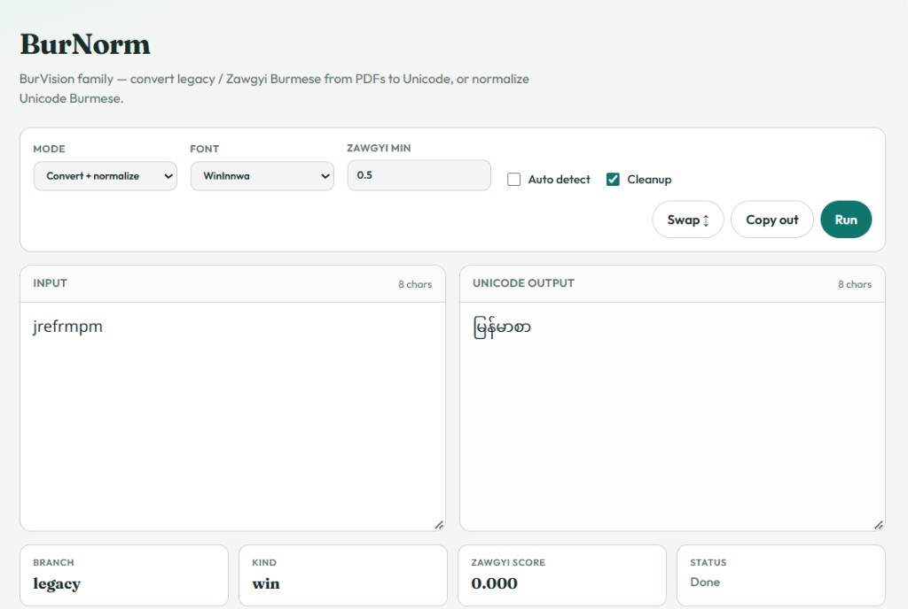
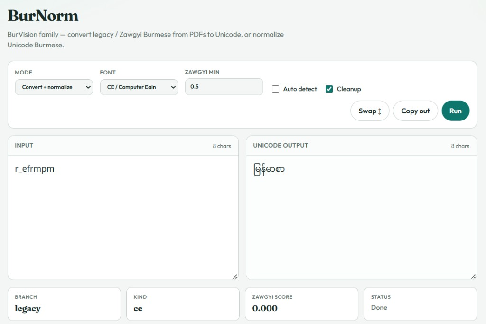
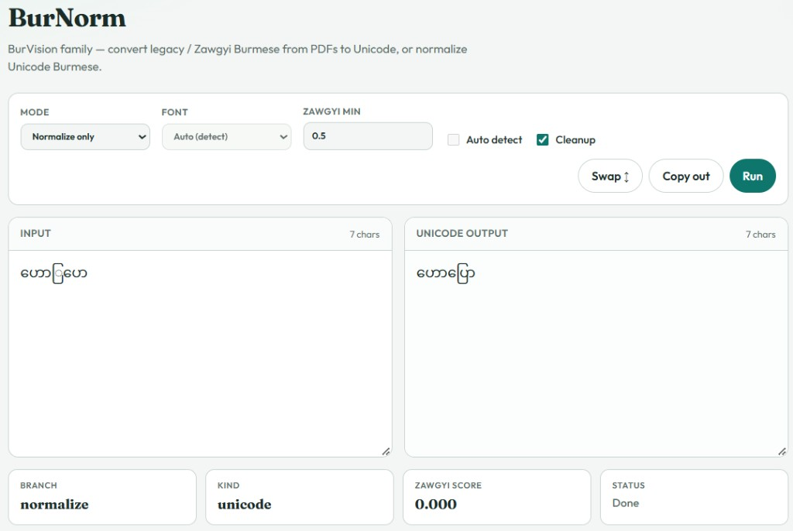

# BurNorm

**Burmese encoding conversion + Unicode normalization.**

Part of the **BurVision** research. BurNorm came out of trying to extract  
Burmese text from PDF books and documents. On many pages the text is not plain  
Myanmar Unicode. Publishers and authors used **different font families and**  
**encodings across decades** — often mixed inside a single PDF — so extracted
strings only make sense under the embedded font.

BurNorm turns that extracted text (and optionally the PDF font name) into clean
Myanmar Unicode you can search, train on, or publish — including a dedicated
`**normalize()**` path for already-Unicode Burmese.

```text
extracted PDF text  →  BurNorm  →  Unicode Burmese
  (legacy font / Zawgyi / broken order)
```

This package only does **encoding → Unicode + normalize**. It does not open
PDFs or ship font binaries.

---

## Research context

While extracting Burmese text from PDFs, three encoding natures kept showing up:

1. **Legacy ASCII/ANSI fonts** — text stored as Latin bytes; the *font glyph

   map* is what makes it look Burmese on screen (WinInnwa, Academy, CE, …).
2. **Zawgyi** — uses Myanmar Unicode codepoints, but in a non-standard visual

   order / private conventions incompatible with modern Unicode rendering.
3. **Unicode fonts** — already Myanmar Unicode (Pyidaungsu, Padauk, Myanmar3, …),

   but extraction can still leave mark-order damage, kinzi leftovers, and
    invisible characters.

BurNorm packages the conversion tables, Zawgyi path, and normalization rules
needed for that mixed-font extract setting.

---

## Font support at a glance

| Layer                            | Count     | Role                                                                                                      |
| -------------------------------- | --------: | --------------------------------------------------------------------------------------------------------- |
| Legacy conversion **tables**     | **11**    | Actual OE / syllable maps used to decode text                                                             |
| Legacy encoding **kinds**        | **11**    | `win`, `academy`, `ce`, `myazedi`, `legacy`, `gandamar`, `king`, `wwin`, `msheavy`, `kannaka`, `mmyanmar` |
| Recognized **font-name aliases** | **~100+** | PDF face names mapped to a kind/table (Win alone ≈ 22; CE family ≈ 11; …)                                 |
| Known **Unicode face names**     | **~38**   | Treated as already-Unicode (normalize / passthrough, not remapped)                                        |
| **Zawgyi**                       | 1 path    | Rabbit rules + extraction pre-repair + quality gate                                                       |

### The 11 legacy conversion tables

`WinInnwa` · `Academy` · `CE` · `MyaZedi` · `Metrix` · `Gandamar` · `King` ·
`WwinBurmese` · `MSHEAVY` · `Kannaka` · `MMyanmar1`

### How font *natures* differ

| Nature                    | What the bytes are                                                   | Typical PDF fonts                                                                                                   | What BurNorm does                                                                                    |
| ------------------------- | -------------------------------------------------------------------- | ------------------------------------------------------------------------------------------------------------------- | ---------------------------------------------------------------------------------------------------- |
| **Legacy (ASCII-mapped)** | Latin letters / punctuation that a proprietary font draws as Burmese | WinInnwa family, Academy, Computer Eain (CE), MyaZedi, Metrix, Gandamar, King, Wwin, MS Heavy, Kannaka, MMyanmar, … | Look up the face → apply the matching **Burglish OE table** (WinInnwa also has a syllable converter) |
| **Zawgyi**                | Myanmar-range codepoints in Zawgyi spelling/order                    | Zawgyi-One and variants                                                                                             | Pre-repair common extract glitches → **Rabbit** → Phase 1 quality gate                               |
| **Unicode**               | Real Myanmar Unicode                                                 | Pyidaungsu, Padauk, Myanmar Text, Noto Sans Myanmar, …                                                              | Skip remapping; run `**normalize()`** (order repair, Kinzi, NFC cleanup)                             |

Legacy fonts are not “wrong Unicode” — they are a **different encoding layer**.
Without the font (or a conversion table), extracted Latin-looking strings are
meaningless as Burmese. Zawgyi *looks* like Myanmar characters but breaks
Unicode collation, search, and rendering. Unicode still needs normalization
when extractors reorder `ေ` / `ြ` or leave damaged marks.

Font names in this project are **identifiers only** (as reported by PDF
extractors). No `.ttf` / `.otf` binaries are shipped, and this work is not
affiliated with font vendors.

---

## Install

```bash
pip install -e ".[detect]"
```

`myanmartools` (Google myanmar-tools) is optional but recommended for Zawgyi auto-detect.

---

## Quick start

```python
from burnorm import convert, normalize, to_unicode

# One call after extract: detect / convert / normalize
unicode_text = to_unicode(raw_text)                 # == convert(raw_text, auto=True)

# When the embedded PDF font name is known
unicode_text = convert(raw_text, font="WinInnwa")
unicode_text = convert(raw_text, font="Academy")
unicode_text = convert(raw_text, font="Zawgyi-One")

# Already Unicode Burmese — repair order / marks only
clean = normalize(unicode_burmese)

# Diagnostics (branch, Zawgyi score, phase stats)
from burnorm import convert_with_stats
result = convert_with_stats(raw_text, font="CE")
print(result.branch, result.kind, result.zawgyi_score)
print(result.text)
```

### CLI

```bash
# Convert (+ normalize) — pass a font hint when you know it from the PDF
burnorm input.txt -o out.txt --font WinInnwa
burnorm input.txt -o out.txt --auto --stats

# Normalize Unicode Burmese only
burnorm input.txt -o out.txt --normalize

python -m burnorm input.txt --kind zawgyi
```

---

## Pipeline

```text
extracted text (+ optional PDF font name)
   → legacy table (11 OE maps / WinInnwa syllable)  OR  Zawgyi repair + Rabbit
   → normalize (Phase 2 order repair + Kinzi + NFC cleanup)
   → Unicode Burmese
```

| Input | Method |
| --- | --- |
| WinInnwa family | Burglish OE map + WinInnwa syllable converter |
| Academy, CE, MyaZedi, Metrix, Gandamar, King, Wwin, MSHeavy, Kannaka, MMyanmar | Burglish OE tables |
| Zawgyi | Extraction pre-repair → Rabbit → quality-gated Phase 1 |
| Already Unicode | `normalize()` — Phase 2 + Kinzi + cleanup |

`normalize()` skips encoding conversion and only runs Unicode repair — useful
when the book is already Unicode but extraction left visual-order damage.

### Zawgyi extraction repair

Extracted Zawgyi often has spaces inside syllables or swapped marks
(`န႔ ဲ`, `ေတကြ`, …). Before Rabbit, `convert(..., auto=True)` runs a
conservative pre-repair (`zg_repair`). Best-effort: badly damaged lines may
still need manual fixes.

---

## Local test webpage

```bash
pip install -e ".[detect]"
python web/app.py
```

Open http://127.0.0.1:8765 — examples cover Auto/Zawgyi, each legacy table,
Unicode, and normalize-only cases.

### Screenshots

**WinInnwa → Unicode** (`jrefrmpm` → `မြန်မာစာ`)



**CE / Computer Eain → Unicode** (`r_efrmpm` → `မြန်မာစာ`)



**Normalize only** (visual-order repair)



---

## Develop

```bash
python -m venv .venv
# Windows
.venv\Scripts\activate
pip install -e ".[dev]"
pytest
```

---

## License

**Apache License 2.0** for this project’s original code.

Third-party components (Rabbit, Burglish tables, WinInnwa converter, optional
myanmar-tools) remain under their own licenses. See [`NOTICE`](NOTICE) and
[`THIRD_PARTY.md`](THIRD_PARTY.md).

### Publishing notes

- Safe to publish: conversion **tables** and converter **code** (MIT / Apache sources, attributed).
- Do **not** add proprietary `.ttf` / `.otf` font files or copyrighted book corpora to this repo.
- Font names are identifiers only; this project is not affiliated with font vendors.
- Conversion is best-effort; legacy encodings and damaged extracts are lossy and not guaranteed 100% correct.

---

## Scope

| In scope | Out of scope |
| --- | --- |
| Legacy font / Zawgyi → Unicode | Opening or parsing PDFs |
| Burmese Unicode normalization | Shipping font binaries |
| Font-name hints from extractors | Full document layout tooling |
| CLI + small local web tester | |

BurNorm is intentionally narrow: the encoding / normalize step that shows up
when you extract Burmese text from mixed-font PDFs.
